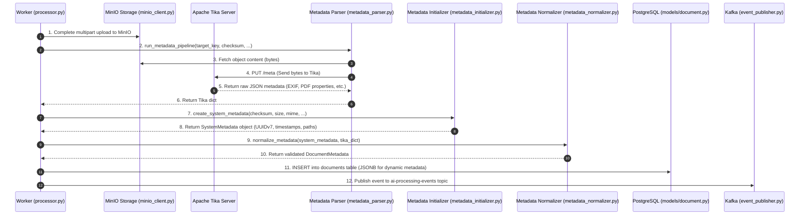

# End-to-End Metadata Architecture & Pipeline Guide

This document explains the lifecycle of file metadata in the Data Ingestion Module: how metadata is extracted, created, normalized, stored in PostgreSQL, and handed off to the downstream AI tag generation pipeline.

---

## 1. High-Level Lifecycle Diagram

The metadata pipeline runs inside the streaming worker after a file's chunks have passed MIME validation and SHA-256 deduplication checks.



---

## 2. File-by-File Responsibilities & Interactions

### 1. `src/ingestion/worker/processor.py` (The Orchestrator)
- **Role:** Central worker routine that consumes Kafka jobs and coordinates streaming upload, deduplication, metadata processing, database storage, and event dispatch.
- **How it coordinates metadata:**
  - Streams file chunks from source connector (S3 or NAS).
  - First chunk is verified with `python-magic` via `validator.py`.
  - Calculates SHA-256 digest on the fly.
  - If the SHA-256 hash is already in PostgreSQL, it aborts upload and logs a `DuplicateLink`.
  - If new, it completes the MinIO upload and invokes `run_metadata_pipeline()`.
  - Persists the final record using SQLAlchemy and triggers the Kafka event.

### 2. `src/ingestion/storage/metadata_parser.py` (Extraction)
- **Role:** Extracts embedded, existing metadata from files (EXIF tags, PDF authors, audio bitrates).
- **Communication:**
  - Calls `MinIOClient.get_object_content(object_key)` to retrieve the raw file bytes.
  - Sends an asynchronous HTTP PUT request to Apache Tika server at `http://tika:9998/meta`.
  - Parses the response through the Pydantic model `TikaMetadata` ([src/ingestion/schemas/metadata.py](file:///c:/Users/hrbrv/.gemini/antigravity/scratch/data-ingestion/src/ingestion/schemas/metadata.py)).
  - If Tika fails or the file has no embedded metadata, it safely falls back to returning an empty dictionary `{}` without crashing the job.

### 3. `src/ingestion/storage/metadata_initializer.py` (System Metadata Creation)
- **Role:** Generates immutable, core system attributes.
- **Attributes Created:**
  - `document_id`: Time-sortable **UUIDv7** using `uuid-utils`.
  - `created_at`: UTC timestamp of ingestion.
  - `checksum_sha256`: SHA-256 hex digest.
  - `size_bytes`: Total byte length.
  - `mime_type`: Validated MIME type from `libmagic`.
  - `storage_path`: MinIO object key (e.g. `raw/{checksum}`).
  - `source_connector_id`: UUID of the source connector.
  - `source_ref`: Original source file path / S3 key.

### 4. `src/ingestion/storage/metadata_normalizer.py` (Normalization & Merging)
- **Role:** Merges `SystemMetadata` and extracted `tika_metadata` into a single, validated `DocumentMetadata` Pydantic model.
- **Communication:**
  - Takes `SystemMetadata` and attaches the dictionary from Tika into the `tika_metadata` property.
  - Validates constraints (e.g., non-negative file size, exactly 64-char lowercase hex checksum).

### 5. `src/ingestion/models/document.py` (Database Persistence)
- **Role:** SQLAlchemy ORM model representing the `documents` table in PostgreSQL.
- **Data persistence:**
  - Maps top-level structured fields to fixed columns (`id`, `checksum_sha256`, `size_bytes`, `mime_type`, `storage_path`, `source_ref`).
  - Maps `tika_metadata` directly to a PostgreSQL **`JSONB`** column.

### 6. `src/ingestion/storage/event_publisher.py` (Downstream Dispatch)
- **Role:** Broadcasts an event to Kafka topic `ai-processing-events` after the document is committed to PostgreSQL so the AI pipeline knows new data is ready.

---

## 3. How New / Dynamic Attributes Are Handled

### Why No Dynamic Column Creation is Needed
In relational databases, creating new physical columns on every new file attribute (e.g. altering the table for EXIF `CameraModel`, `GPSAltitude`, `AudioCodec`, `PageCount`) is an anti-pattern that leads to schema instability and locks.

Instead, the architecture uses PostgreSQL's native **`JSONB`** column type in `documents.tika_metadata`.

```sql
CREATE TABLE documents (
    id                  UUID PRIMARY KEY,
    checksum_sha256     TEXT NOT NULL UNIQUE,
    size_bytes          BIGINT NOT NULL,
    mime_type           TEXT NOT NULL,
    storage_path        TEXT NOT NULL,
    source_connector_id UUID REFERENCES connectors(id),
    source_ref          TEXT NOT NULL,
    created_at          TIMESTAMPTZ NOT NULL,
    tika_metadata       JSONB                  -- Dynamic attributes live here
);
```

### Schema Extensibility via Pydantic (`extra="allow"`)
In [src/ingestion/schemas/metadata.py](file:///c:/Users/hrbrv/.gemini/antigravity/scratch/data-ingestion/src/ingestion/schemas/metadata.py#L50), `TikaMetadata` is configured with:

```python
model_config = {"populate_by_name": True, "extra": "allow"}
```

- **Known attributes** (e.g. `tiff:Make`, `geo:lat`, `xmpTPg:NPages`) are cleanly parsed into typed fields.
- **Any unknown / novel attribute** discovered in a file is automatically captured into the dictionary without errors.
- The entire dictionary is stored in the `tika_metadata` JSONB column.

---

## 4. Querying Metadata in PostgreSQL (For AI Pipeline)

The AI tag generation team connecting to AWS RDS can query both standard columns and nested dynamic metadata using PostgreSQL JSONB operators (`->` and `->>`):

### Query 1: Extract Images with Specific Camera Information
```sql
SELECT 
    id,
    storage_path,
    tika_metadata->>'tiff:Make' AS camera_make,
    tika_metadata->>'tiff:Model' AS camera_model
FROM documents
WHERE mime_type LIKE 'image/%';
```

### Query 2: Extract PDFs with Page Counts
```sql
SELECT 
    id,
    storage_path,
    tika_metadata->>'dc:title' AS title,
    (tika_metadata->>'xmpTPg:NPages')::INT AS page_count
FROM documents
WHERE mime_type = 'application/pdf';
```

### Query 3: Search Documents Containing Specific Attributes
```sql
-- Find documents that have GPS coordinates
SELECT id, storage_path, tika_metadata->>'geo:lat', tika_metadata->>'geo:long'
FROM documents
WHERE tika_metadata ? 'geo:lat';
```

---

## 5. Summary Matrix of Metadata Pipeline

| Step | Stage | File | Input | Output |
|---|---|---|---|---|
| 1 | **Extract** | `metadata_parser.py` | Object key in MinIO | Extracted metadata dictionary from Tika |
| 2 | **Create** | `metadata_initializer.py` | Ingestion context (size, hash, MIME) | `SystemMetadata` (UUIDv7, timestamps, paths) |
| 3 | **Normalize** | `metadata_normalizer.py` | `SystemMetadata` + Tika dict | Canonical `DocumentMetadata` Pydantic model |
| 4 | **Persist** | `processor.py` + `document.py` | `DocumentMetadata` | PostgreSQL `documents` table row (with `JSONB`) |
| 5 | **Publish** | `event_publisher.py` | `DocumentMetadata` | Event published to Kafka `ai-processing-events` |
